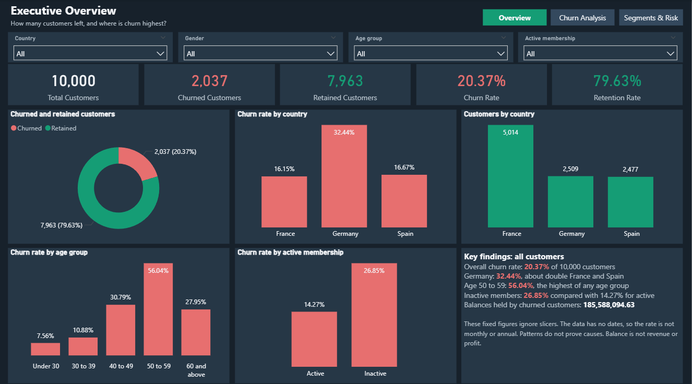
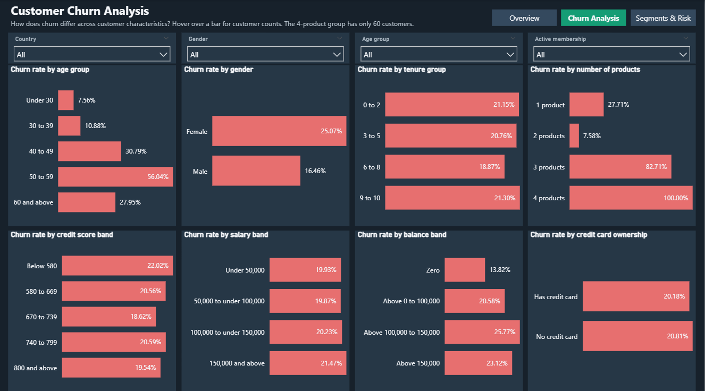
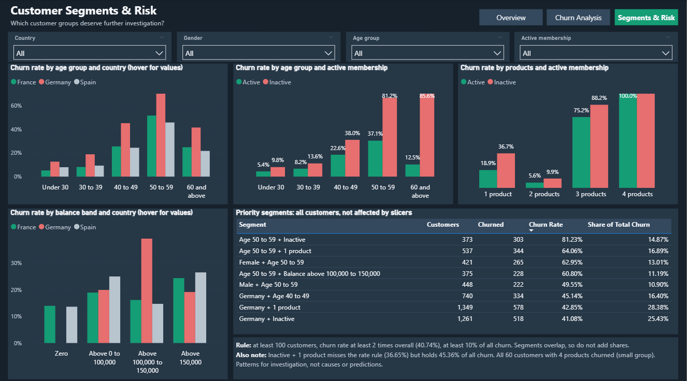
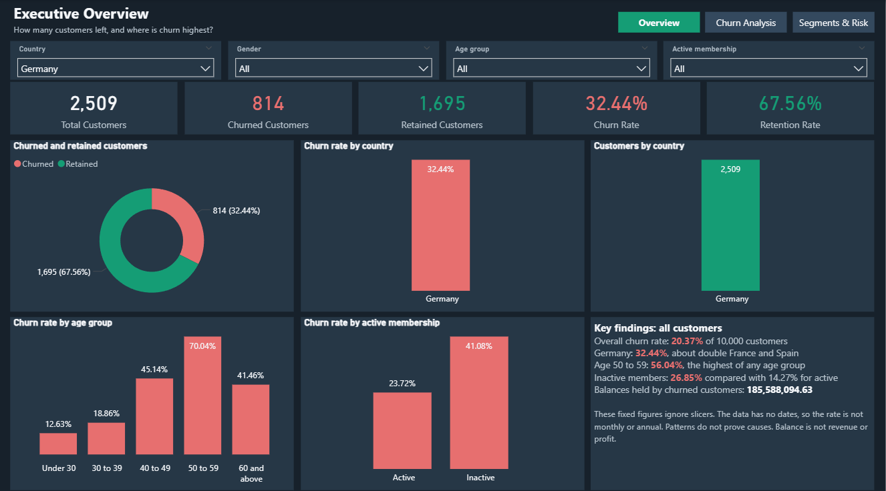
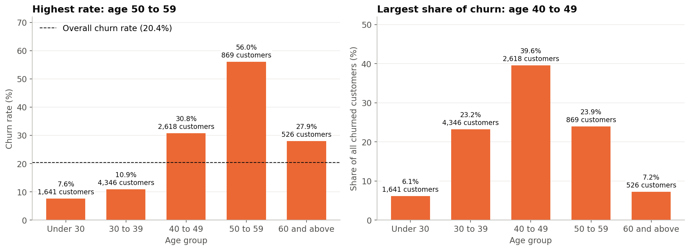
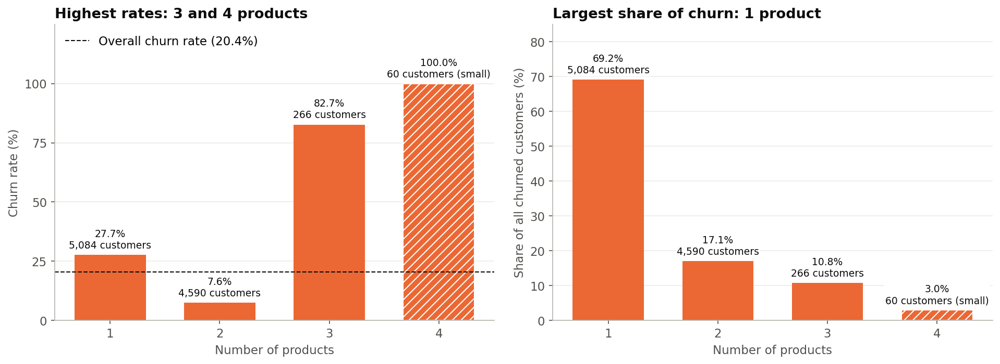
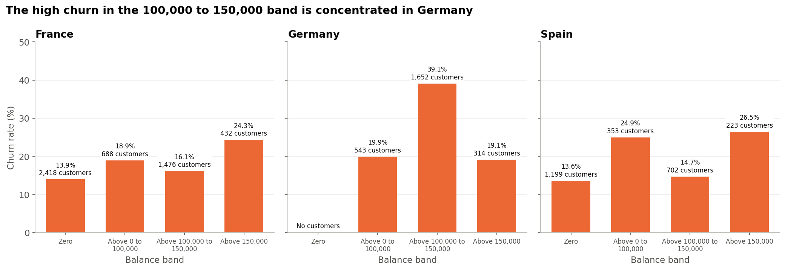
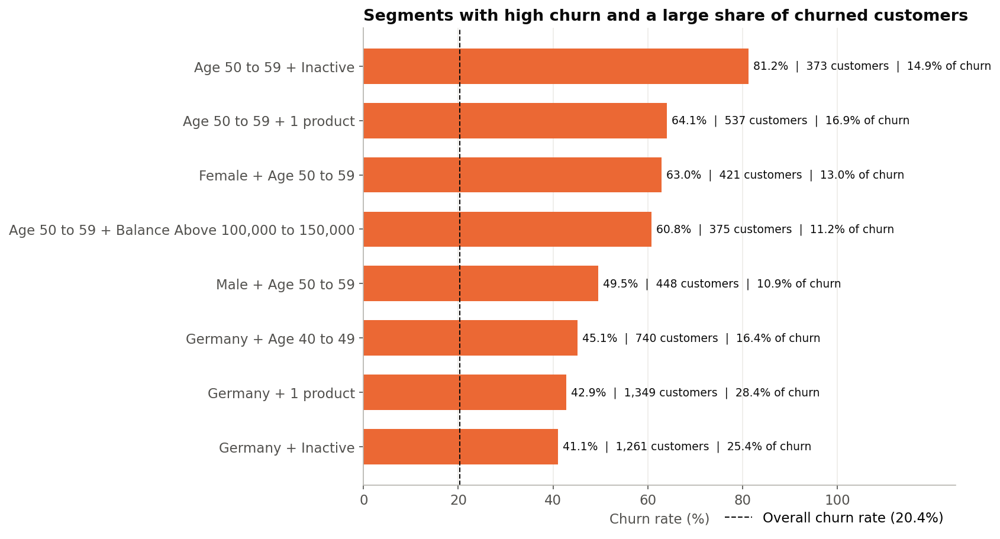

# Bank Customer Churn Analysis

An end-to-end data analyst project on 10,000 bank customers: data profiling and cleaning in Python, exploratory analysis, business questions answered again in MySQL, and an interactive three-page Power BI dashboard.

> **In one line:** about 1 in 5 customers left (20.37%). Churn is concentrated among customers aged 40 to 59, German customers with balances of 100,000 to 150,000, inactive customers and customers holding only one product.



---

## Business problem

A bank wants to know which customers are leaving so it can focus its retention effort. The project answers 10 business questions: how many customers left, which countries, ages, activity levels and product holdings have the highest churn, and which combinations of characteristics form the highest-priority groups.

## Key results

| KPI | Value |
|---|---:|
| Customers analysed | 10,000 |
| Customers who left | 2,037 |
| Churn rate | 20.37% |
| Churn rate, Germany | 32.44% (about double France and Spain) |
| Churn rate, age 50 to 59 | 56.04% (against 7.56% under 30) |
| Churn rate, inactive vs active | 26.85% vs 14.27% |
| Leavers who were inactive with one product | 45.36% |

## Key findings

- **Age is the strongest pattern.** Churn rises sharply from age 40 and peaks at 56.04% for ages 50 to 59. Ages 40 to 49 produce the most leavers because the group is larger.
- **Germany's high rate is concentrated.** German customers with balances of 100,000 to 150,000 churn at 39.10%; other German customers are close to the overall rate.
- **Inactive customers leave almost twice as often** and make up 63.92% of all leavers.
- **Two products is the sweet spot.** Two-product customers churn least (7.58%); one-product customers are 69.17% of all leavers. Three- and four-product groups churn very heavily but are small.
- **Women left more often than men** (25.07% vs 16.46%).
- **Tenure, credit card ownership, credit score and salary made little difference.**
- **Priority segments:** 162 two-way combinations were tested against three rules (at least 100 customers, at least twice the overall rate, at least 10% of leavers). Eight groups qualified, all in two clusters: ages 50 to 59 and German customers.

## Dashboard

Three Power BI pages in a charcoal and emerald theme, with slicers for country, gender, age group and active membership on every page.

| Page | What it shows |
|---|---|
| **Executive Overview** | Headline KPIs, churn by country, age and activity, key findings |
| **Customer Churn Analysis** | Churn rate across eight customer characteristics |
| **Customer Segments & Risk** | Two-way comparisons and the priority segments table |

| | |
|---|---|
|  |  |
| **Customer Churn Analysis** | **Customer Segments & Risk** |

Slicer test, filtered to Germany:



## Exploratory analysis

| | |
|---|---|
|  |  |
|  |  |

All 11 charts are in [`reports/eda_charts`](reports/eda_charts).

## Recommendations to test

| # | Recommendation | Why |
|---|---|---|
| 1 | Record why and when customers leave | Without it, causes cannot be learned |
| 2 | Re-engage inactive customers with one product | They are 45.36% of all leavers |
| 3 | Review German customers with balances of 100,000 to 150,000 | 39.10% churn against about 15% to 16% elsewhere |
| 4 | Research the needs of customers aged 40 to 59 | 34.87% of customers but 63.48% of leavers |
| 5 | Check 3- and 4-product customers before promoting more products | Very high churn in small groups |
| 6 | Test whether a useful second product helps one-product customers | Two-product customers churn least |
| 7 | Track results over time with the dashboard | Dated data is needed to measure improvement |

Each idea should be tested on part of a group against a comparison group before being rolled out. Age and gender alone should never drive pricing or offers.

## Tools

| Tool | Used for |
|---|---|
| **Python** (pandas, Matplotlib, Seaborn) | Profiling, cleaning, feature banding, EDA, charts |
| **Jupyter Notebook** | Cleaning and EDA notebooks |
| **MySQL 8.0** | Database setup and five SQL analysis scripts (aggregations, CASE, CTEs) |
| **Power BI Desktop** (DAX) | Three-page interactive dashboard |

## How it was built

| Phase | Work | Validation |
|---|---|---|
| 1. Business understanding | Defined the problem, 10 questions and the KPIs | |
| 2. Data understanding | Read-only profiling of size, types, missing values, duplicates and outliers | |
| 3. Cleaning | Cleaned copy with five band columns (age, tenure, credit score, salary, balance); no rows removed | 24 / 24 checks |
| 4. EDA | Churn rate and share of leavers for every group; 11 charts | 42 / 42 checks |
| 5. SQL | Same questions answered in MySQL | 24 / 24 measures match Python |
| 7. Power BI | Three-page dashboard | 380 / 380 values match Python |
| 8. Recommendations | Findings turned into testable actions | |

Phase 6 (advanced modelling) was skipped by design: this is an analysis project, not a prediction model.

## Project structure

```text
├── Bank Customer Churn Prediction.csv   original data (never modified)
├── data/processed/                      cleaned data with band columns
├── scripts/                             data inspection script
├── notebooks/                           cleaning and EDA notebooks
├── sql/                                 MySQL scripts 01 to 05
├── powerbi/                             .pbix file and Power BI project (.pbip)
├── reports/
│   ├── dashboard_screenshots/
│   └── eda_charts/
├── outputs/                             script and SQL output logs
├── docs/                                phase reports, data dictionary, full project report
└── Project_Report.docx
```

## How to run it

1. Install the libraries:

```bash
pip install pandas matplotlib seaborn jupyter
```

2. Run `scripts/phase_2_data_inspection.py`, then the notebooks in `notebooks/` in order.
3. MySQL: copy `data/processed/bank_churn_cleaned.csv` to your MySQL `secure-file-priv` folder and run the scripts in `sql/` in numeric order. Steps are in [the SQL phase report](docs/Phase_5_SQL_Business_Analysis.md).
4. Power BI: open `powerbi/Bank_Customer_Churn_Dashboard.pbix` in Power BI Desktop.

## Limitations

- The data shows **where** churn is higher, not **why** customers left.
- No dates, so churn trends over time cannot be shown, and the churn period is unknown.
- No revenue or profit data. The 185.6 million balance held by leavers is a balance, not lost revenue.
- Kaggle lists the data's origin as unknown, and some column meanings (such as "active member") are not officially documented.
- Small groups (for example 60 four-product customers) should be read with caution.

## Documentation

- [Project report](docs/Project_Report.md): the full story in plain language
- [Complete project documentation](docs/Complete_Project_Documentation.md)
- [Data dictionary](docs/Data_Dictionary.md)
- Phase reports in [`docs/`](docs)

## Data source

[Kaggle: Bank Customer Churn Dataset](https://www.kaggle.com/datasets/gauravtopre/bank-customer-churn-dataset)
