# Phase 4: Exploratory Data Analysis (EDA)

| Item | Details |
|---|---|
| **Project** | Bank Customer Churn Analysis |
| **Phase** | 4 of 9 |
| **Date** | 7 November 2026 |
| **Status** | Complete and approved |
| **Data used** | [`data/processed/bank_churn_cleaned.csv`](../data/processed/bank_churn_cleaned.csv) (unchanged) |
| **Notebook** | [`notebooks/phase_4_exploratory_data_analysis.ipynb`](../notebooks/phase_4_exploratory_data_analysis.ipynb) |
| **Charts** | [`reports/eda_charts/`](../reports/eda_charts/) (11 charts) |

> **How to read this report:** these results show patterns, not causes. The data cannot say why customers left. Balance is an account amount, not revenue or profit. Retention recommendations belong to Phase 8.

---

## 1. Main Findings

1. **About 1 in 5 customers churned:** 2,037 of 10,000 customers (20.37%).
2. **Age shows the largest gap among groups of substantial size.** Customers aged 50 to 59 have a 56.04% churn rate, compared with 7.56% for those under 30.
3. **Product holdings show sharp differences.** Churn is 7.58% with 2 products and 27.71% with 1 product. It is much higher with 3 products (82.71%) and 4 products (100%), but those groups are small.
4. **Germany's churn rate is about double the other countries' (32.44%).** This is concentrated among German customers with balances above 100,000 to 150,000.
5. **Inactive members and female customers churn more often** than active members and male customers.
6. **Tenure, credit card ownership, credit score and salary show little difference** when viewed one at a time.

### Three different views of "highest churn"

| View | What it means | Main examples |
|---|---|---|
| **Highest churn rate** | Customers in this group are the most likely to have left | Ages 50 to 59 (56.04%), Germany (32.44%), inactive members (26.85%) |
| **Largest contribution to total churn** | This group accounts for the most churned customers | 1 product (69.17%), inactive members (63.92%), female customers (55.92%) |
| **High rate, but small group** | The rate is striking, but few customers are involved | 4 products (100%, **60 customers, flagged**), 3 products (82.71%, 266 customers) |

---

## 2. Overall KPIs

| KPI | Result |
|---|---|
| **Total customers** | 10,000 |
| **Churned customers** | 2,037 |
| **Retained customers** | 7,963 |
| **Churn rate** | 20.37% |
| **Retention rate** | 79.63% |
| **Active member rate** | 51.51% |
| **Average products per customer** | 1.53 |
| **Total balance held by churned customers** | 185,588,094.63 |
| **Share of all balances held by churned customers** | 24.26% (of 764,858,892.88) |

Amounts have no currency symbol because the currency is not documented. The churned balance figure is **not lost revenue or profit**.

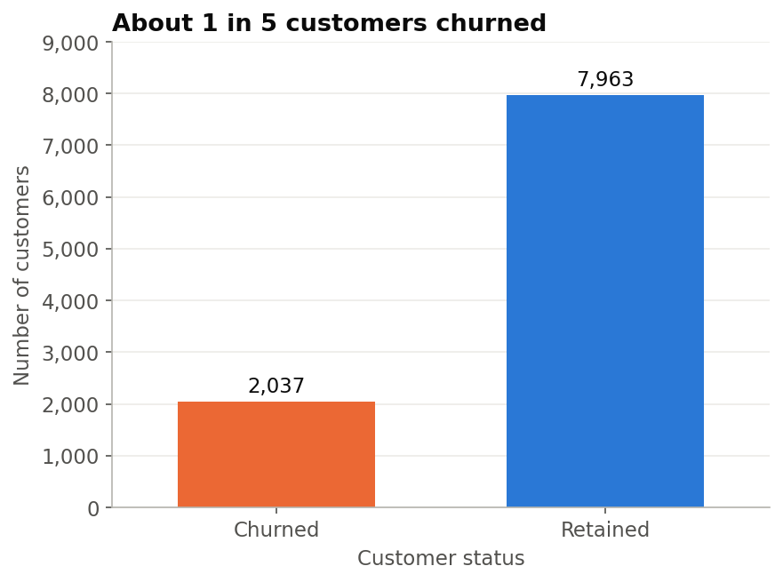

---

## 3. Customer Group Results

**Churn rate** = churned in group ÷ customers in group. **Share of churn** = churned in group ÷ all 2,037 churned customers.

### Country

| Group | Customers | Churned | Retained | Churn rate | Share of churn |
|---|---:|---:|---:|---:|---:|
| France | 5,014 | 810 | 4,204 | 16.15% | 39.76% |
| Germany | 2,509 | 814 | 1,695 | 32.44% | 39.96% |
| Spain | 2,477 | 413 | 2,064 | 16.67% | 20.27% |

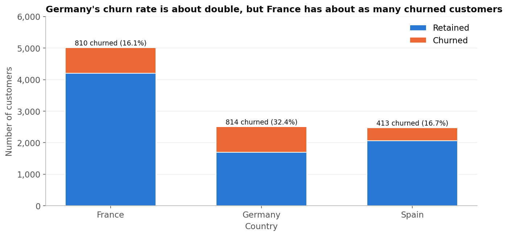

### Gender

| Group | Customers | Churned | Retained | Churn rate | Share of churn |
|---|---:|---:|---:|---:|---:|
| Female | 4,543 | 1,139 | 3,404 | 25.07% | 55.92% |
| Male | 5,457 | 898 | 4,559 | 16.46% | 44.08% |

### Active membership

| Group | Customers | Churned | Retained | Churn rate | Share of churn |
|---|---:|---:|---:|---:|---:|
| Inactive | 4,849 | 1,302 | 3,547 | 26.85% | 63.92% |
| Active | 5,151 | 735 | 4,416 | 14.27% | 36.08% |

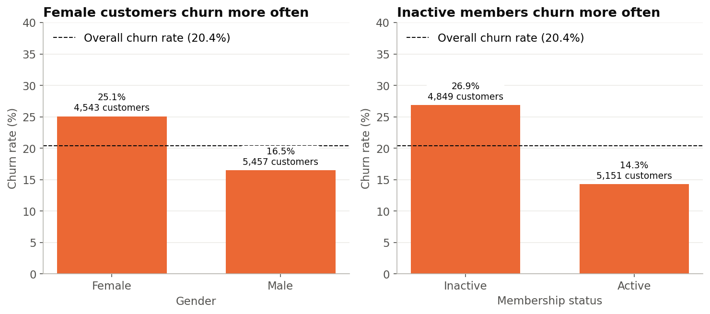

### Age group

| Group | Customers | Churned | Retained | Churn rate | Share of churn |
|---|---:|---:|---:|---:|---:|
| Under 30 | 1,641 | 124 | 1,517 | 7.56% | 6.09% |
| 30 to 39 | 4,346 | 473 | 3,873 | 10.88% | 23.22% |
| 40 to 49 | 2,618 | 806 | 1,812 | 30.79% | 39.57% |
| 50 to 59 | 869 | 487 | 382 | 56.04% | 23.91% |
| 60 and above | 526 | 147 | 379 | 27.95% | 7.22% |

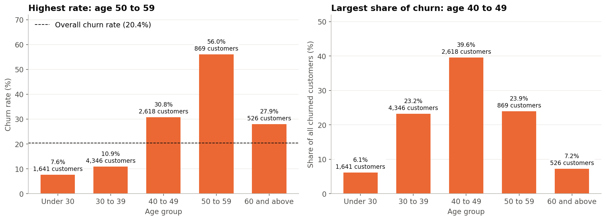

### Number of products

| Group | Customers | Churned | Retained | Churn rate | Share of churn |
|---|---:|---:|---:|---:|---:|
| 1 product | 5,084 | 1,409 | 3,675 | 27.71% | 69.17% |
| 2 products | 4,590 | 348 | 4,242 | 7.58% | 17.08% |
| 3 products | 266 | 220 | 46 | 82.71% | 10.80% |
| 4 products **(small group)** | 60 | 60 | 0 | 100.00% | 2.95% |

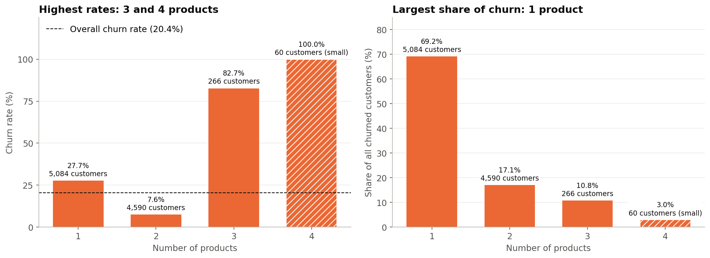

### Balance band

| Group | Customers | Churned | Retained | Churn rate | Share of churn |
|---|---:|---:|---:|---:|---:|
| Zero | 3,617 | 500 | 3,117 | 13.82% | 24.55% |
| Above 0 to 100,000 | 1,584 | 326 | 1,258 | 20.58% | 16.00% |
| Above 100,000 to 150,000 | 3,830 | 987 | 2,843 | 25.77% | 48.45% |
| Above 150,000 | 969 | 224 | 745 | 23.12% | 11.00% |

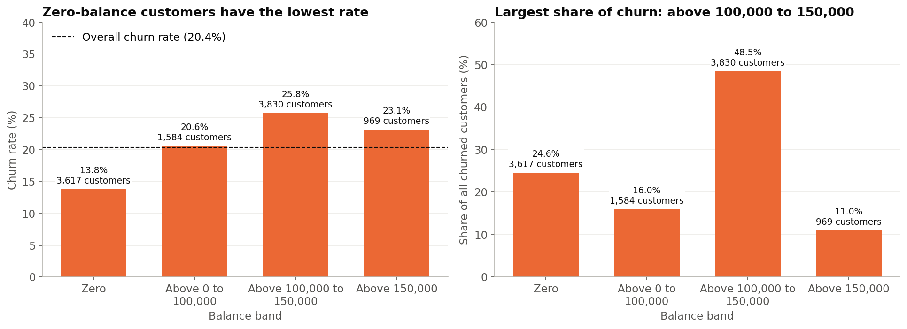

### Balance band within each country

Phase 2 flagged that Germany has no zero-balance customers, so these two characteristics need to be read together.

| Balance band | France | Germany | Spain |
|---|---:|---:|---:|
| Zero | 13.94% (2,418) | No customers | 13.59% (1,199) |
| Above 0 to 100,000 | 18.90% (688) | 19.89% (543) | 24.93% (353) |
| Above 100,000 to 150,000 | 16.12% (1,476) | **39.10% (1,652)** | 14.67% (702) |
| Above 150,000 | 24.31% (432) | 19.11% (314) | 26.46% (223) |

*Each cell shows the churn rate, with the number of customers in brackets.*

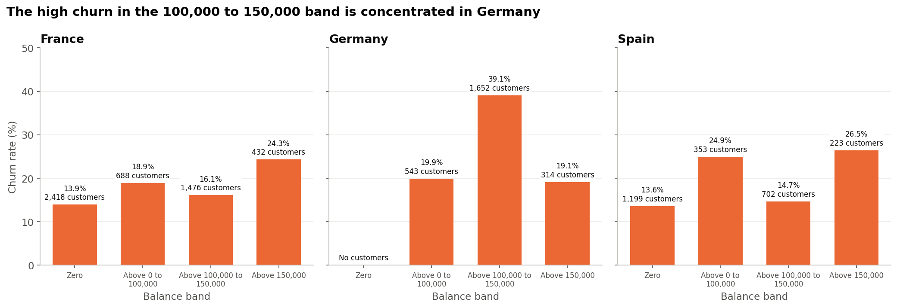

### Tenure group

| Group | Customers | Churned | Retained | Churn rate | Share of churn |
|---|---:|---:|---:|---:|---:|
| 0 to 2 | 2,496 | 528 | 1,968 | 21.15% | 25.92% |
| 3 to 5 | 3,010 | 625 | 2,385 | 20.76% | 30.68% |
| 6 to 8 | 3,020 | 570 | 2,450 | 18.87% | 27.98% |
| 9 to 10 | 1,474 | 314 | 1,160 | 21.30% | 15.41% |

### Credit card ownership

| Group | Customers | Churned | Retained | Churn rate | Share of churn |
|---|---:|---:|---:|---:|---:|
| No credit card | 2,945 | 613 | 2,332 | 20.81% | 30.09% |
| Has credit card | 7,055 | 1,424 | 5,631 | 20.18% | 69.91% |

### Credit score band

| Group | Customers | Churned | Retained | Churn rate | Share of churn |
|---|---:|---:|---:|---:|---:|
| Below 580 | 2,362 | 520 | 1,842 | 22.02% | 25.53% |
| 580 to 669 | 3,331 | 685 | 2,646 | 20.56% | 33.63% |
| 670 to 739 | 2,428 | 452 | 1,976 | 18.62% | 22.19% |
| 740 to 799 | 1,224 | 252 | 972 | 20.59% | 12.37% |
| 800 and above | 655 | 128 | 527 | 19.54% | 6.28% |

### Salary band

| Group | Customers | Churned | Retained | Churn rate | Share of churn |
|---|---:|---:|---:|---:|---:|
| Under 50,000 | 2,453 | 489 | 1,964 | 19.93% | 24.01% |
| 50,000 to under 100,000 | 2,537 | 504 | 2,033 | 19.87% | 24.74% |
| 100,000 to under 150,000 | 2,555 | 517 | 2,038 | 20.23% | 25.38% |
| 150,000 and above | 2,455 | 527 | 1,928 | 21.47% | 25.87% |

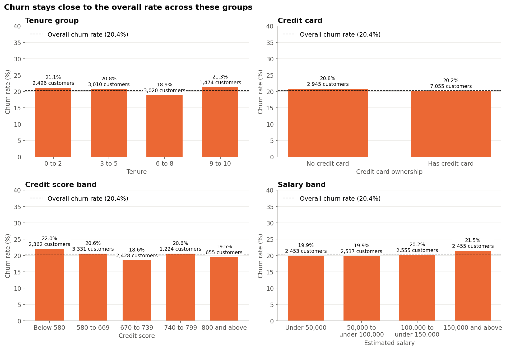

---

## 4. Churned and Retained Customers Compared

| Average | Churned | Retained | Difference |
|---|---:|---:|---:|
| **Age** | 44.84 | 37.41 | +7.43 |
| **Credit score** | 645.35 | 651.85 | -6.50 |
| **Tenure** | 4.93 | 5.03 | -0.10 |
| **Account balance** | 91,108.54 | 72,745.30 | +18,363.24 |
| **Estimated salary** | 101,465.68 | 99,738.39 | +1,727.29 |
| **Number of products** | 1.48 | 1.54 | -0.07 |

*Differences are calculated before rounding, so some may not exactly match the rounded averages.*

**The balance average needs care.** Among customers with a balance above zero, the averages are almost equal: 120,746.97 for churned customers and 119,535.86 for retained customers. The overall gap mainly reflects that fewer churned customers have a zero balance (24.55%, compared with 39.14% of retained customers).

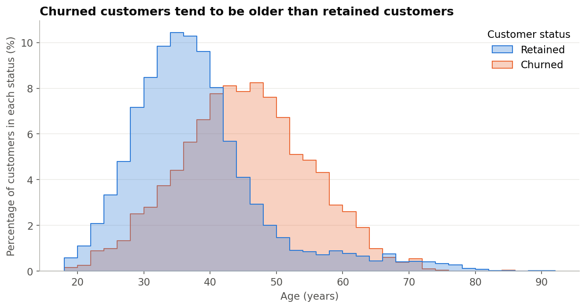

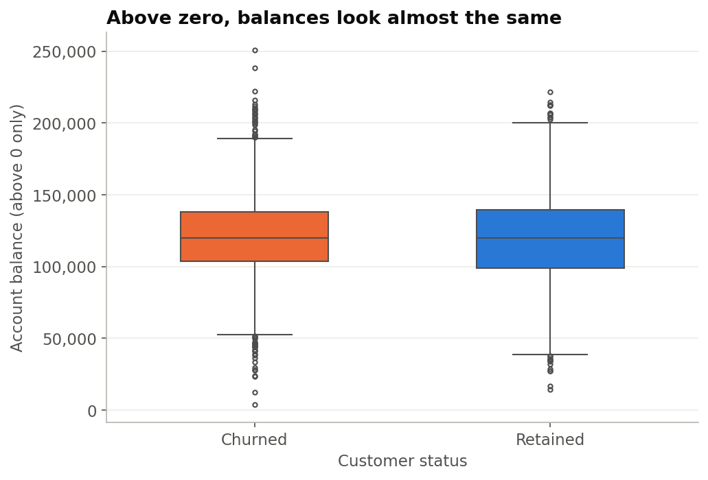

---

## 5. Answers to the 10 Business Questions

**Q1. How many customers have churned, and what is the overall churn rate?**
2,037 of 10,000 customers churned, a rate of 20.37%. The time period is not defined, so this is not an annual or monthly rate.

**Q2. Which countries have the highest churn?**
Germany has the highest rate (32.44%), about double Spain (16.67%) and France (16.15%). Germany and France contribute almost the same number of churned customers (814 and 810). Germany's rate overlaps strongly with one balance band (see Q8).

**Q3. Does churn differ between female and male customers?**
Yes. The rate is 25.07% for female customers and 16.46% for male customers. Female customers are 45.43% of all customers but 55.92% of churned customers. This does not mean gender is a cause.

**Q4. Which age groups are most likely to leave?**
Ages 50 to 59 have the highest rate (56.04%), followed by 40 to 49 (30.79%) and 60 and above (27.95%). Ages 40 to 49 contribute the most churned customers (39.57%), because that group is about three times larger than the 50 to 59 group. Rates are lowest under 30 (7.56%) and at 30 to 39 (10.88%).

**Q5. Are newer customers more likely to leave than long-standing customers?**
The data does not show a clear pattern. Rates run from 18.87% to 21.30%, and the highest is in the longest-tenure group (9 to 10), just above the newest group (0 to 2, at 21.15%).

**Q6. Do inactive members churn more than active members?**
Yes. The rate is 26.85% for inactive members and 14.27% for active members. Inactive members are 48.49% of customers but 63.92% of churned customers. The data does not define "active".

**Q7. How does churn change with the number of products, and with credit card ownership?**
- **Products:** the rate is 27.71% with 1 product, 7.58% with 2, 82.71% with 3 and 100% with 4. So holding more products does not simply go with lower churn.
- **Contribution:** customers with 1 product contribute the most churned customers (69.17%).
- **Small group:** the 4-product group has only 60 customers and is flagged as small. Every one of them churned, which is unusual enough to query with the data owner if that were possible.
- **Credit card:** there is almost no difference (20.81% without a card and 20.18% with one).

**Q8. Do customers with higher balances leave more often, and how much balance is held by churned customers?**
Partly. Zero-balance customers have the lowest rate (13.82%), and "Above 100,000 to 150,000" has the highest (25.77%), but the pattern does not simply rise with balance, as "Above 150,000" is lower (23.12%). The pattern also varies by country: that 100,000 to 150,000 band is 39.10% in Germany, but 16.12% in France and 14.67% in Spain. Churned customers hold 185,588,094.63 in total, or 24.26% of all balances.

**Q9. Does churn differ by credit score band or salary band?**
Only slightly. Credit score bands range from 18.62% to 22.02%, and salary bands from 19.87% to 21.47%. Salary findings need extra caution because of the data concerns found in Phase 2.

**Q10. Which combinations of characteristics form the highest-priority segments?**
See the next section. This is a first screening, and Phase 6 can look deeper.

---

## 6. Combined Segments (Question 10)

We checked 162 combinations, using every pair of six characteristics: country, gender, age group, active status, products and balance band.

**Working rule for a priority segment:** at least 100 customers, a churn rate at least 2 times the overall rate (40.74% or higher) and at least 10% of all churned customers. This is a simple screening choice made for this project, not a bank standard.

**Segments overlap, so their shares must not be added together.** For example, one customer can be in both "Age 50 to 59 + Inactive" and "Age 50 to 59 + 1 product".

### Priority segments

| Segment | Customers | Churned | Churn rate | Share of churn |
|---|---:|---:|---:|---:|
| Age 50 to 59 + Inactive | 373 | 303 | 81.23% | 14.87% |
| Age 50 to 59 + 1 product | 537 | 344 | 64.06% | 16.89% |
| Female + Age 50 to 59 | 421 | 265 | 62.95% | 13.01% |
| Age 50 to 59 + Balance above 100,000 to 150,000 | 375 | 228 | 60.80% | 11.19% |
| Male + Age 50 to 59 | 448 | 222 | 49.55% | 10.90% |
| Germany + Age 40 to 49 | 740 | 334 | 45.14% | 16.40% |
| Germany + 1 product | 1,349 | 578 | 42.85% | 28.38% |
| Germany + Inactive | 1,261 | 518 | 41.08% | 25.43% |

These form two clusters: **customers aged 50 to 59** and **German customers**.

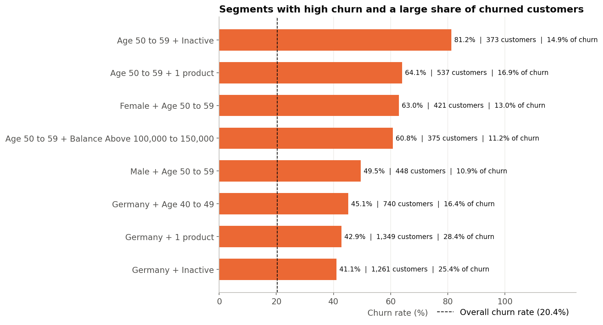

### Largest contribution, with a lower rate

These segments do not meet the rate rule, but they contain many churned customers:

| Segment | Customers | Churned | Churn rate | Share of churn |
|---|---:|---:|---:|---:|
| Inactive + 1 product | 2,521 | 924 | 36.65% | 45.36% |
| Female + 1 product | 2,296 | 762 | 33.19% | 37.41% |
| Female + Inactive | 2,259 | 725 | 32.09% | 35.59% |

### High rate, but too small for the rule

| Segment | Customers | Churned | Churn rate | Share of churn | Why it was not selected |
|---|---:|---:|---:|---:|---|
| 3 products + Balance above 100,000 to 150,000 | 103 | 97 | 94.17% | 4.76% | Under 10% of churn |
| Inactive + 3 products | 153 | 135 | 88.24% | 6.63% | Under 10% of churn |
| Age 60 and above + Inactive | 111 | 95 | 85.59% | 4.66% | Under 10% of churn |

### Flagged small segments

**29 of the 162 combinations have fewer than 100 customers**, so they were excluded from the priority list. 16 of them involve 4 products, and all 16 show 100% churn because every 4-product customer churned. Examples include Female + 4 products (38 customers) and Germany + 4 products (24 customers). These rates should not be relied on alone.

---

## 7. Business Observations

| Finding | What the data shows | Why it matters to the bank | Limitations |
|---|---|---|---|
| **Older middle-aged customers** | Churn is 30.79% at 40 to 49 and 56.04% at 50 to 59. Average age is 44.84 for churned customers and 37.41 for retained customers | These two age groups are 34.87% of customers but 63.48% of churned customers | Age may be linked to other factors not in the data, such as life stage |
| **Product holdings** | 2 products: 7.58%. 1 product: 27.71%. 3 products: 82.71% | 1-product customers are the largest source of churn, while the 3- and 4-product results stand out as unusual | The data does not name the products, or show whether customers reduced their holdings before leaving |
| **Germany and balance** | German customers in the 100,000 to 150,000 band have a 39.10% rate and are 31.71% of all churn. Other German customers have a 19.60% rate | A country-wide view could hide that the high rate sits largely in one part of the German customer base | No information on local market conditions, products or competitors |
| **Inactive members** | Rate of 26.85%, compared with 14.27% for active members | Activity status is a characteristic the bank can already see for each customer | "Active" is undefined, and it is not known when activity was measured |
| **Gender** | Rate of 25.07% for female customers and 16.46% for male customers | Shows a sizeable gap between two large customer groups | It is not a cause, and the data does not explain the gap |
| **Characteristics with little difference** | Tenure, credit card, credit score and salary each stay within 3.40 points | Viewed alone, these do not help much to separate churned from retained customers | They might still matter in combination. Salary data has quality concerns |

**General limitations:** the churn period is undefined, there are no dates or reasons for leaving, and Kaggle lists the data's original source as "Unknown". Findings may not apply to banks in general.

---

## 8. Validation

**Notebook checks: 42 of 42 passed.**

| Check | Result |
|---|---|
| 10,000 customers and 17 CSV columns | Pass |
| Churned (2,037) and retained (7,963) match Phase 2, and add up to the total | Pass |
| Churn rate + retention rate = 100% | Pass |
| No missing values | Pass |
| For all 10 characteristics, group totals add up to 10,000 / 2,037 / 7,963 | Pass |
| For all 10 characteristics, shares of churn add up to 100% | Pass |
| For all 10 characteristics, churn rates agree with a second calculation (crosstab) | Pass |
| Age, tenure, credit score, salary and balance counts match Phase 3 | Pass |
| Cleaned CSV fingerprint is unchanged | Pass |

**Separate cross-check without pandas:** a separate script recalculated the KPIs, group tables, averages, balance totals and priority segments using Python's basic `csv` tool, then confirmed that those figures appear correctly in this report.

**Denominators:** group rates use customers in that group, shares of churn use all 2,037 churned customers, and the balance share uses the total of all balances.
