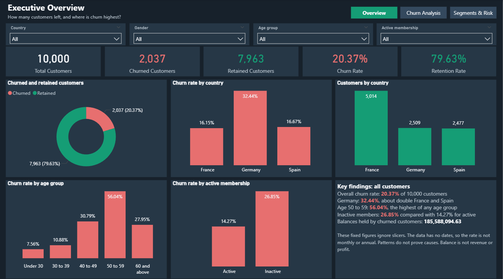
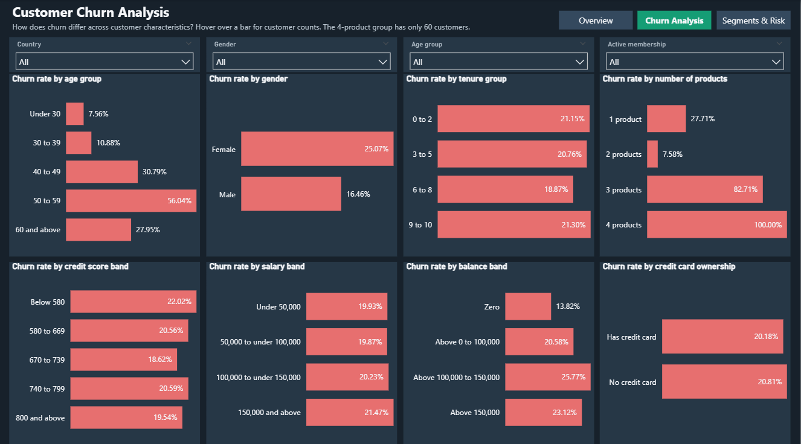
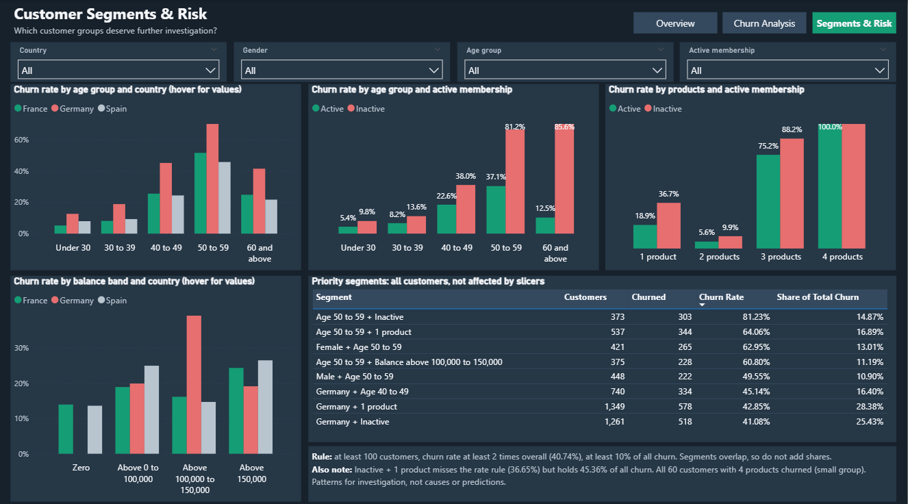
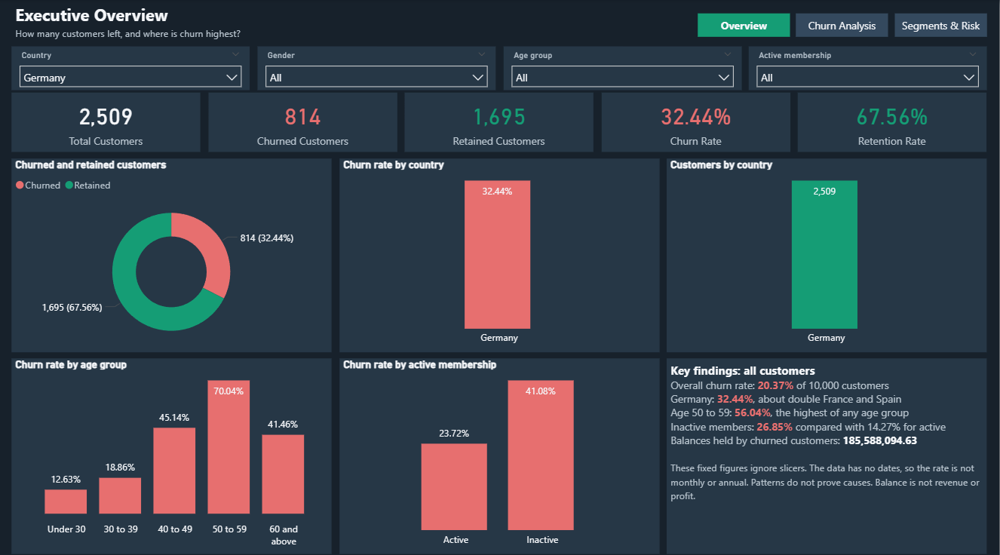

# Phase 7: Power BI Dashboard

| Item | Details |
|---|---|
| **Project** | Bank Customer Churn Analysis |
| **Phase** | 7 of 9 (Phase 6 was intentionally skipped) |
| **Date** | 7 November 2026 |
| **Status** | Complete and approved by the user. `.pbix` saved in the `powerbi` folder |
| **Report** | [`powerbi/Bank_Customer_Churn_Dashboard.pbip`](../powerbi/Bank_Customer_Churn_Dashboard.pbip) |
| **Data source** | [`data/processed/bank_churn_cleaned.csv`](../data/processed/bank_churn_cleaned.csv) (unchanged) |
| **Screenshots** | [`reports/dashboard_screenshots/`](../reports/dashboard_screenshots/) |

> **How to read this dashboard:** it shows patterns, not causes or predictions. The data has no dates, so the churn rate is not monthly or annual. Balance is an account amount, not revenue or profit.

---

## 1. Current Status

| Item | Status |
|---|---|
| Report opens in Power BI Desktop 2.148 | **Done** |
| CSV loads with 10,000 customers | **Done** |
| All three pages display correctly | **Done** (checked from screenshots) |
| Measures match a fresh calculation from the CSV | **Done** (380 of 380 checks) |
| Saved slicer selection filters the page | **Done** (Germany test on page 1) |
| `.pbix` file | **Done.** Saved by the user as `powerbi/Bank_Customer_Churn_Dashboard.pbix` |
| Clicking slicers, navigation buttons and hover tooltips | **Manual check.** Interactive behaviour is tested by hand in Power BI Desktop (steps below) |

### What you need to do

The report is a **Power BI Project (`.pbip`)**, a folder of text files that Power BI Desktop opens like a normal report. It doesn't store the data, so it loads the data from the CSV.

1. **Open the report.** Double-click `powerbi/Bank_Customer_Churn_Dashboard.pbip`, or use the window that is already open.
2. **Load the data, if needed.** If the visuals show (Blank), select **Refresh now** on the yellow banner, or **Home > Refresh**.
3. **Test the slicers.** On Executive Overview, set Country to Germany. The cards should show 2,509 customers, 814 churned and 32.44%. Then open the other two pages and confirm that the selection carries over.
4. **Test navigation.** Hold **Ctrl** and click the buttons at the top right. In Power BI Desktop, buttons need Ctrl while you are editing.
5. **Test a tooltip.** Hover over a Churn Rate bar. It should show customers, churned customers and churn contribution.
6. **Create the `.pbix`.** Select **File > Save as**, choose **Power BI file (*.pbix)**, and save it in the `powerbi` folder as `Bank_Customer_Churn_Dashboard.pbix`.

**If you move the project folder:** select **Home > Transform data > Edit parameters**, update `ProjectFolder`, and refresh.

---

## 2. Dashboard Objective and Pages

The dashboard helps a bank see how many customers left, which groups have higher churn rates, which groups contribute the most churned customers, and which groups deserve further investigation.

All pages share a title, navigation buttons and four slicers: Country, Gender, Age group and Active membership.

### Page 1: Executive Overview

| Visual | Why it is useful |
|---|---|
| **5 KPI cards** | Show the main totals and rates at a glance |
| **Churned and retained donut** | Shows the split between two groups, which suits a donut |
| **Churn rate by country** | Shows that Germany's rate is about double the others |
| **Customers by country** | Adds context: France has about twice as many customers |
| **Churn rate by age group** | Shows the peak at ages 50 to 59 |
| **Churn rate by active membership** | Compares inactive and active members |
| **Key findings text** | States the main results and their limits. These fixed figures ignore slicers |

### Page 2: Customer Churn Analysis

Eight horizontal bar charts show the churn rate by age group, gender, tenure group, number of products, credit score band, salary band, balance band and credit card ownership. Horizontal bars keep long labels such as "100,000 to under 150,000" readable, and the shared format makes the page quick to scan.

The page shows which characteristics separate customers clearly (age, products, gender) and which show little difference (tenure, credit card, credit score and salary).

### Page 3: Customer Segments & Risk

| Visual | Why it is useful |
|---|---|
| **Churn rate by age group and country** | Shows how age patterns differ by country |
| **Churn rate by age group and active membership** | Shows that inactive members churn more in every age group |
| **Churn rate by products and active membership** | Shows that the gap holds at 1, 2 and 3 products |
| **Churn rate by balance band and country** | Shows the concentration in Germany's 100,000 to 150,000 band |
| **Priority segments table** | Lists groups that meet the screening rule |
| **Rule and notes** | Explains the rule, and flags Inactive + 1 product and the small 4-product group |

The two charts with three countries hide data labels, because they overlapped. Their exact values appear in the tooltips.

**Priority rule:** at least 100 customers, a churn rate at least 2 times overall (40.74%) and at least 10% of all churned customers.

---

## 3. Data Model

The model has one customer table, `bank_customers`, with one row per customer, and one small results table, `Priority Segments`.

| Added item | Where | Why |
|---|---|---|
| 5 hidden order columns, such as `Age Group Order` | Power Query | Keep groups in their natural order instead of alphabetical order |
| `Customer Status`, `Membership Status`, `Credit Card Status`, `Products Held` | DAX columns | Show readable labels instead of 0 and 1 |
| `Priority Segments` | DAX calculated table | Combines two characteristics per row, which a single chart field cannot do |

These additions exist only inside the report, so the CSV is not changed.

**Why the order columns are in Power Query:** Power BI reported a circular dependency when they were DAX columns built from the same group column. Creating them in Power Query avoids this.

**About the `Priority Segments` table:** its numbers are calculated from the data, but its list of 8 segments was chosen using the Phase 4 and 5 results. If the data ever changes, the list needs reviewing. It has no link to the customer table, so slicers don't change it.

---

## 4. DAX Measures

| Measure | DAX | Simple explanation |
|---|---|---|
| **Total Customers** | `COUNTROWS(bank_customers)` | Counts rows, and each row is one customer |
| **Churned Customers** | `SUM(bank_customers[churn])` | Adds the churn column, where 1 means the customer left |
| **Retained Customers** | `[Total Customers] - [Churned Customers]` | Customers who did not leave |
| **Churn Rate** | `DIVIDE([Churned Customers], [Total Customers])` | Of the customers selected, the share who left |
| **Retention Rate** | `DIVIDE([Retained Customers], [Total Customers])` | Of the customers selected, the share who stayed |
| **Churn Contribution %** | `DIVIDE([Churned Customers], CALCULATE([Churned Customers], ALL(bank_customers)))` | The selected group's share of **all 2,037** churned customers |
| **Total Customer Balance** | `SUM(bank_customers[balance])` | Adds account balances. Not revenue or profit |
| **Churned Customer Balance** | `CALCULATE([Total Customer Balance], bank_customers[churn] = 1)` | Adds balances held by churned customers. Not lost revenue or profit |

**Why `DIVIDE`:** it avoids an error if a selection has no customers.

**Why `ALL` matters in Churn Contribution %:** `ALL(bank_customers)` removes filters from the denominator, so it stays at 2,037. Without `ALL`, a selected group would always show 100%, because it would be divided by itself. For example, Germany correctly shows 39.96%.

**Slicers and churn contribution:** with Germany selected, Churn Contribution % still compares against all 2,037 churned customers, not only German ones. This matches the definition used in Phases 4 and 5.

---

## 5. Design Choices

**Palette 3: Dark Charcoal & Emerald**

| Purpose | Hex | Used for |
|---|---|---|
| Main background | `#17212B` | Page background |
| Visual background | `#263746` | Cards, charts and slicers |
| Primary highlight | `#159D75` | Retained customers, active members, the current page button, France |
| Secondary highlight | `#39C69A` | Reserved in the theme, and not used on any page, so that the charts don't become too green |
| Secondary elements | `#34495E` | Inactive page buttons, table header and grid |
| Main text | `#F5F7FA` | Titles, values and labels |
| Churn warning | `#E76F6F` | Churn rates, churned customers, inactive members, Germany |
| Secondary text | `#B8C4CE` | Subtitles, legends and small notes, and Spain's bars |

**Other choices**
- **Colour meaning:** in the comparison charts, France, Germany and Spain keep the same colours on every chart, and so do Active and Inactive.
- **Simple styling:** there are no gradients, shadows, icons or decorative borders.
- **Chart types:** only one donut is used, and bars handle the comparisons.
- **Theme file:** the palette is saved in `powerbi/Bank_Customer_Churn_Dashboard.Report/StaticResources/RegisteredResources/Dark_Charcoal_Emerald.json`.

---

## 6. Validation

A separate script queried the running Power BI model, recalculated the same figures from the cleaned CSV with pandas, and compared them.

**Result: 380 of 380 checks passed.**

| Check | Result |
|---|---|
| All 10,000 customers are present | Pass |
| Customer IDs are unique (10,000 different IDs) | Pass |
| Churned 2,037 and retained 7,963 | Pass |
| Churn rate 20.37% and retention rate 79.63% | Pass |
| All 8 measures across 37 customer groups, including country, age, membership and products | Pass |
| Measures under 7 filter combinations, as slicers would apply them | Pass |
| Churn contribution uses all 2,037 churned customers | Pass |
| Priority table has the same 8 segments as the rule applied to all 162 combinations | Pass |
| Cleaned and original CSV fingerprints are unchanged | Pass |

**Required findings**

| Finding | Dashboard value |
|---|---|
| Overall churn rate | 20.37% |
| Germany churn rate | 32.44% |
| Age 50 to 59 churn rate | 56.04% |
| Inactive customers churn rate | 26.85% |
| Female churn rate | 25.07% |
| Customers with 4 products | 100% churn, 60 customers |
| Inactive + 1 product share of all churn | 45.36% |
| Balances held by churned customers | 185,588,094.63 |

### Slicer test

A temporary copy of the report opened with Germany saved as the Country selection. Every visual on page 1 responded except the fixed Key findings text, as designed. The cards showed 2,509 customers, 814 churned and 32.44%.

### Checks that could not be completed

| Check | Why | What to do |
|---|---|---|
| Clicking slicers and syncing them across pages | Needs manual interaction in Power BI Desktop | Step 3 in Section 1 |
| Clicking navigation buttons | Same reason. The buttons and their targets are set up | Step 4 |
| Hover tooltips | Same reason. The tooltip fields are set up | Step 5 |
| Microsoft Store version of Power BI (2.159) | Testing used the other installed version (2.148) | Reopen the report if double-clicking opens the Store version |

---

## 7. Limitations

- **Screenshots:** they were cropped from the Power BI editing window at about 1,326 pixels wide. For sharper portfolio images, use **File > Export > Export to PDF**, or take screenshots with the side panes collapsed.
- **Data limits:** there are no dates or reasons for leaving, the original source is unknown, and salary findings need caution.
- **Unverified meanings:** Active and Inactive assume 1 = active, which Kaggle does not confirm.
- **Small group:** all 60 customers with 4 products churned, which is unusual and rests on a small group.
