# Bank Customer Churn Analysis: Project Report

| | |
|---|---|
| **Project type** | Data Analyst portfolio project |
| **Report date** | 8 November 2026 |
| **Data** | 10,000 bank customers ([Kaggle: Bank Customer Churn Dataset](https://www.kaggle.com/datasets/gauravtopre/bank-customer-churn-dataset)) |
| **Tools** | Python, MySQL, Power BI |
| **Status** | Phases 1 to 8 complete. Phase 9 (GitHub publishing) is paused |

---

## Contents

1. [Executive Summary](#1-executive-summary)
2. [Background: What Is Customer Churn?](#2-background-what-is-customer-churn)
3. [Project Objectives](#3-project-objectives)
4. [The Data](#4-the-data)
5. [What We Did, Step by Step](#5-what-we-did-step-by-step)
6. [Business Questions and Answers](#6-business-questions-and-answers)
7. [Extra Questions the Analysis Answered](#7-extra-questions-the-analysis-answered)
8. [Key Findings](#8-key-findings)
9. [The Dashboard](#9-the-dashboard)
10. [Recommendations](#10-recommendations)
11. [How We Checked the Results](#11-how-we-checked-the-results)
12. [Limitations](#12-limitations)
13. [Conclusion](#13-conclusion)
14. [Glossary](#14-glossary)

---

## 1. Executive Summary

A bank wants to know which customers are leaving, so that it can focus its effort on keeping them. We analysed 10,000 customers using Python, MySQL and Power BI.

**What we found:**
- **About 1 in 5 customers left:** 2,037 customers, a churn rate of 20.37%.
- **Age matters most:** customers aged 50 to 59 left at a rate of 56.04%, compared with 7.56% for customers under 30.
- **Germany stands out:** German customers left at 32.44%, about double France and Spain. Most of this comes from German customers with balances above 100,000 to 150,000 (39.10%).
- **Inactive customers leave more often:** 26.85%, compared with 14.27% for active customers.
- **One-product customers are the biggest source of churn:** inactive customers with one product make up 45.36% of everyone who left.
- **Some things made little difference:** tenure, credit card ownership, credit score and salary.

**What we recommend:** start recording why customers leave, then test ways to keep the groups above, measuring each test against a comparison group.

> **Important:** this analysis shows **where** churn is higher, not **why** customers left. The data cannot prove causes.

---

## 2. Background: What Is Customer Churn?

**Customer churn** means a customer stops using the bank, for example by closing their account and moving to another bank.

**Why it matters:**
- **Lost business:** customers who leave take their money and products with them.
- **Replacement cost:** winning new customers usually costs more than keeping existing ones.
- **Lost growth:** a customer who has left can no longer be offered other products.

**Churn rate** is the percentage of customers who left. For example, if 20 of 100 customers leave, the churn rate is 20%.

---

## 3. Project Objectives

1. Measure how many customers left.
2. Compare churn across customer groups, such as country, age and activity.
3. Find the groups that need the most attention.
4. Show the results in an easy-to-use dashboard.
5. Give practical, evidence-based recommendations.

**Out of scope:** this is a data analysis project, so we did not build machine learning or prediction models.

---

## 4. The Data

The dataset has **10,000 customers**, one row per customer, with 12 columns:

| Column | Meaning |
|---|---|
| `customer_id` | Customer number |
| `credit_score` | Credit score, from 350 to 850 |
| `country` | France, Germany or Spain |
| `gender` | Female or Male |
| `age` | Age, from 18 to 92 |
| `tenure` | Years with the bank, from 0 to 10 (unit assumed) |
| `balance` | Account balance |
| `products_number` | Number of bank products held, from 1 to 4 |
| `credit_card` | Has a credit card (1 = yes) |
| `active_member` | Is an active customer (1 = yes) |
| `estimated_salary` | Estimated salary |
| `churn` | Left the bank (1 = yes, 0 = no) |

**Data quality:** the data was already clean, with no missing values and no duplicate customers.

**Things to note:**
- **Dates:** there are none, so we cannot show trends over time.
- **Reasons for leaving:** the data doesn't record them.
- **Currency:** none is given, so amounts are shown without a symbol.
- **Undocumented meanings:** Kaggle explains only the `churn` column, so the other meanings are based on the column names.

---

## 5. What We Did, Step by Step

The project followed nine phases. We completed eight of them, skipped Phase 6 on purpose and paused before Phase 9.

### Step 1: Understood the business problem (Phase 1)
- **What we did:** before looking at any numbers, we agreed on the problem, wrote the 10 questions to answer and chose the measures to calculate.
- **Why:** starting with clear questions keeps the analysis focused on what the bank needs.

### Step 2: Explored the raw data (Phase 2)
- **What we did:** we checked the data's size, column types, missing values, duplicates and unusual values, then confirmed the meaning of `churn` on Kaggle.
- **How:** with a Python script that only reads the file, so the data could not be changed by accident.
- **What we learned:** the data was complete. Some values were unusual but not wrong, such as a salary of 11.58, and Germany has no customers with a zero balance.

### Step 3: Cleaned and prepared the data (Phase 3)
- **What we did:** we created a cleaned copy and added five group columns: age group, tenure group, credit score band, salary band and balance band.
- **Why:** groups make patterns easier to see. For example, "50 to 59" is easier to compare than 70 separate ages.
- **How:** with Python (Pandas) in a notebook. The original file was never changed, and all 10,000 customers were kept.

### Step 4: Analysed the data and made charts (Phase 4)
- **What we did:** we calculated churn for every customer group, compared customers who left with those who stayed, and made 11 charts.
- **How:** with Python (Pandas, Matplotlib and Seaborn).

### Step 5: Repeated the analysis in SQL (Phase 5)
- **What we did:** we loaded the data into a MySQL database and answered the same questions with SQL queries.
- **Why:** this shows SQL skills and confirms the Python results.
- **Result:** SQL and Python matched on all 24 key measures.
- **Note:** the scripts ran on a temporary test copy of MySQL. Running them on your own MySQL server has not been confirmed.

### Step 6: Built an interactive dashboard (Phase 7)
- **What we did:** we created a three-page Power BI dashboard with filters, so users can explore the data themselves.
- **Result:** the dashboard's numbers matched the Python results in all 380 checks.

### Step 7: Wrote recommendations (Phase 8)
- **What we did:** we turned the findings into practical next steps and a simple business story.

**Phase 6 (Advanced Analysis)** was skipped by choice, because the earlier analysis already gave enough findings for the dashboard.

---

## 6. Business Questions and Answers

These are the 10 questions set at the start of the project.

### Q1. How many customers left, and what is the churn rate?

| Customers | Number | Percentage |
|---|---:|---:|
| Left (churned) | 2,037 | 20.37% |
| Stayed (retained) | 7,963 | 79.63% |
| **Total** | **10,000** | **100%** |

**Answer:** about 1 in 5 customers left. The data doesn't say over what period, so this is not a monthly or yearly rate.

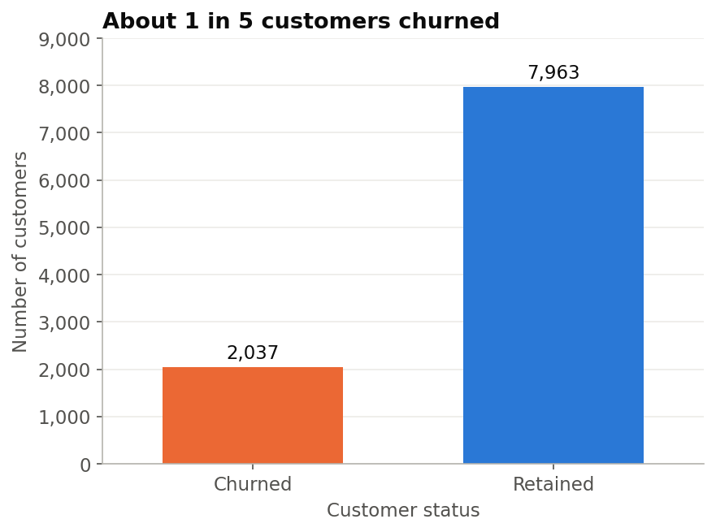

### Q2. Which countries have the highest churn?

| Country | Customers | Left | Churn rate |
|---|---:|---:|---:|
| Germany | 2,509 | 814 | **32.44%** |
| Spain | 2,477 | 413 | 16.67% |
| France | 5,014 | 810 | 16.15% |

**Answer:** Germany, with about double the rate of France and Spain. France still lost almost as many customers (810), because it has twice as many.

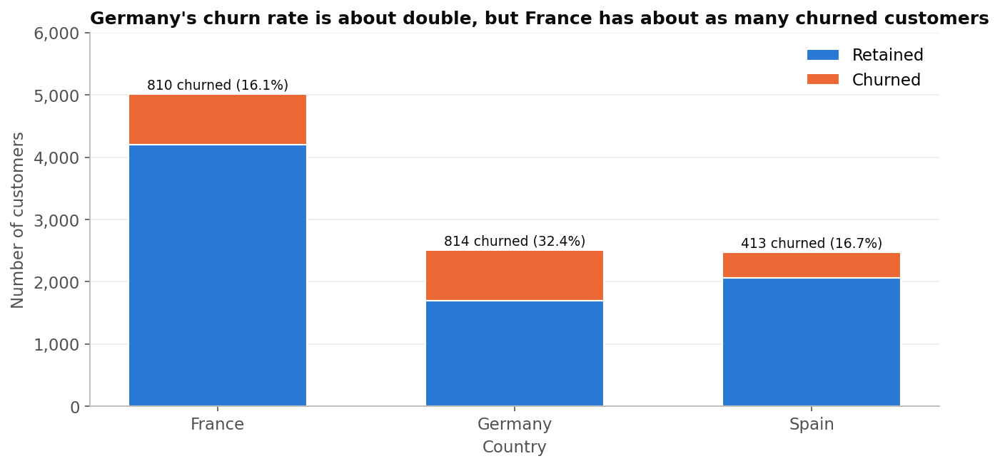

### Q3. Do women and men leave at different rates?

| Gender | Customers | Left | Churn rate |
|---|---:|---:|---:|
| Female | 4,543 | 1,139 | **25.07%** |
| Male | 5,457 | 898 | 16.46% |

**Answer:** yes. Women left more often. This is a pattern only, and the data does not explain why.

### Q4. Which age groups are most likely to leave?

| Age group | Customers | Left | Churn rate |
|---|---:|---:|---:|
| Under 30 | 1,641 | 124 | 7.56% |
| 30 to 39 | 4,346 | 473 | 10.88% |
| 40 to 49 | 2,618 | 806 | 30.79% |
| 50 to 59 | 869 | 487 | **56.04%** |
| 60 and above | 526 | 147 | 27.95% |

**Answer:** customers aged 50 to 59, where more than half left. Customers aged 40 to 49 are the largest group of leavers (806 customers), because there are more of them.

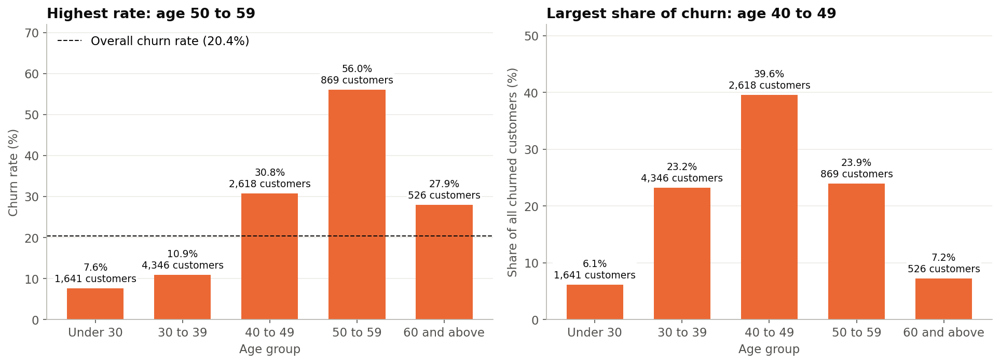

### Q5. Are newer customers more likely to leave?

| Years with the bank | Customers | Churn rate |
|---|---:|---:|
| 0 to 2 | 2,496 | 21.15% |
| 3 to 5 | 3,010 | 20.76% |
| 6 to 8 | 3,020 | 18.87% |
| 9 to 10 | 1,474 | 21.30% |

**Answer:** no clear pattern. New and long-standing customers left at similar rates.

### Q6. Do inactive customers leave more than active customers?

| Status | Customers | Left | Churn rate |
|---|---:|---:|---:|
| Inactive | 4,849 | 1,302 | **26.85%** |
| Active | 5,151 | 735 | 14.27% |

**Answer:** yes. Inactive customers left almost twice as often, and they make up 63.92% of everyone who left.

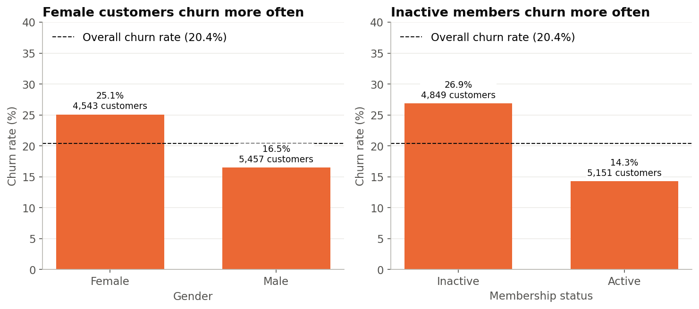

### Q7. How do the number of products and credit card ownership relate to churn?

| Products held | Customers | Left | Churn rate |
|---|---:|---:|---:|
| 1 product | 5,084 | 1,409 | 27.71% |
| 2 products | 4,590 | 348 | **7.58%** (lowest) |
| 3 products | 266 | 220 | 82.71% |
| 4 products | 60 | 60 | 100% (small group) |

**Answer:**
- **2 products:** customers with two products left the least.
- **1 product:** they are the biggest group of leavers (69.17% of everyone who left).
- **3 or 4 products:** very high churn, but these are small groups that need checking before drawing conclusions.
- **Credit card:** made almost no difference (20.81% without a card, 20.18% with one).

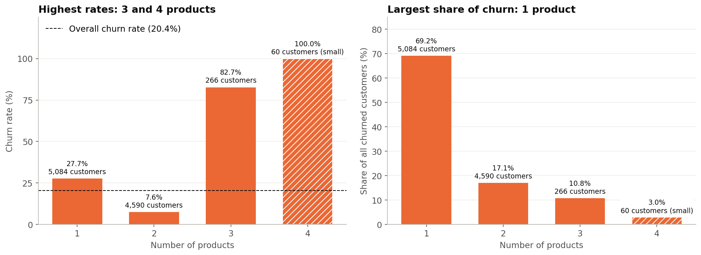

### Q8. Do customers with higher balances leave more?

| Balance | Customers | Churn rate |
|---|---:|---:|
| Zero | 3,617 | 13.82% (lowest) |
| Above 0 to 100,000 | 1,584 | 20.58% |
| Above 100,000 to 150,000 | 3,830 | **25.77%** |
| Above 150,000 | 969 | 23.12% |

**Answer:**
- **Pattern:** partly yes. Customers with a zero balance left least, but churn does not simply rise with balance.
- **Germany:** the 100,000 to 150,000 band is high mainly because of Germany (39.10% there, compared with about 15% to 16% in France and Spain).
- **Balances held:** customers who left held **185,588,094.63** in balances (24.26% of all balances). This is an account balance, not lost profit.

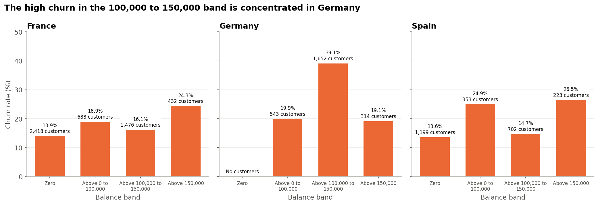

### Q9. Do credit score or salary make a difference?

**Answer:** hardly at all.
- **Credit score:** churn rates ranged only from 18.62% to 22.02% across credit score bands.
- **Salary:** they ranged only from 19.87% to 21.47% across salary bands.

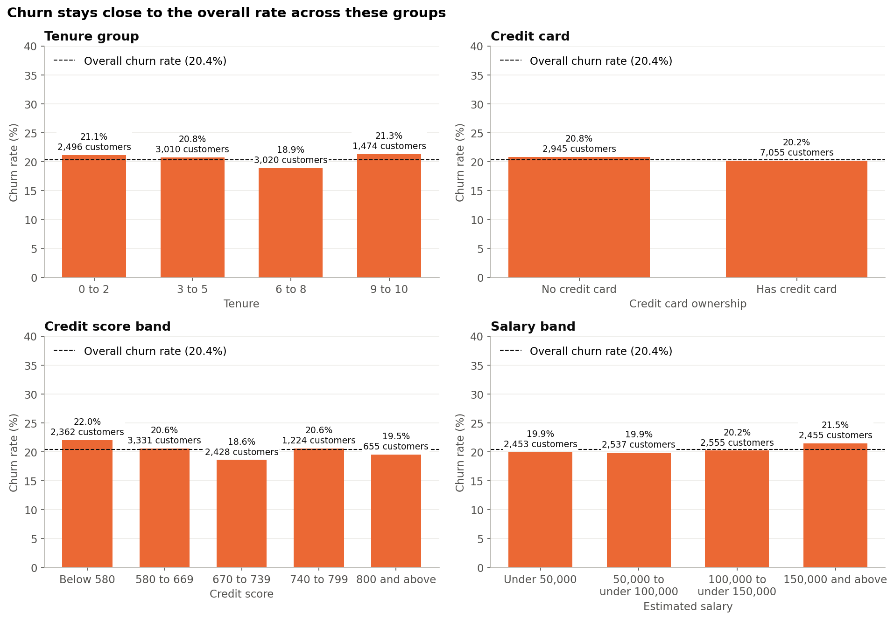

### Q10. Which combinations of characteristics form the highest-priority groups?

We checked 162 combinations of two characteristics. A group counted as a **priority** if it met all three rules:
1. At least 100 customers.
2. A churn rate at least twice the overall rate (40.74% or more).
3. At least 10% of everyone who left.

| Priority group | Customers | Churn rate | Share of all leavers |
|---|---:|---:|---:|
| Age 50 to 59 + Inactive | 373 | 81.23% | 14.87% |
| Age 50 to 59 + 1 product | 537 | 64.06% | 16.89% |
| Female + Age 50 to 59 | 421 | 62.95% | 13.01% |
| Age 50 to 59 + Balance above 100,000 to 150,000 | 375 | 60.80% | 11.19% |
| Male + Age 50 to 59 | 448 | 49.55% | 10.90% |
| Germany + Age 40 to 49 | 740 | 45.14% | 16.40% |
| Germany + 1 product | 1,349 | 42.85% | 28.38% |
| Germany + Inactive | 1,261 | 41.08% | 25.43% |

**Answer:** the priority groups fall into two clusters: **customers aged 50 to 59** and **German customers**. The groups overlap, so their percentages should not be added together.

**Also important:** inactive customers with one product (36.65% churn) don't meet the rate rule, but they make up **45.36%** of everyone who left, more than any other group.

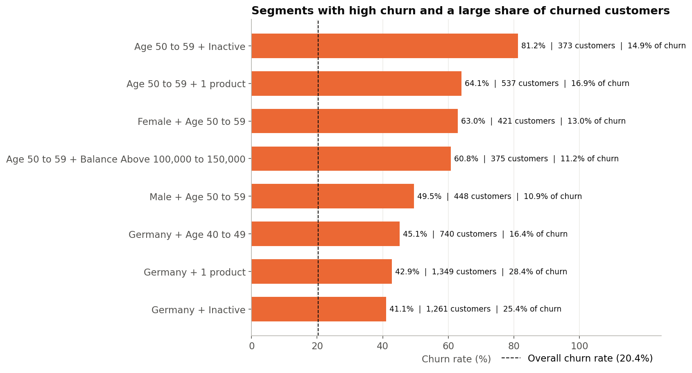

---

## 7. Extra Questions the Analysis Answered

**Is the group with the highest churn rate always the biggest problem?**
No. Ages 50 to 59 have the highest rate (56.04%), but ages 40 to 49 produce the most leavers (39.57% of all), because that group is three times larger. That is why we looked at both the **churn rate** and the **share of all leavers**.

**Do customers who left have more money in the bank?**
At first it looked that way (average balance 91,108.54 for leavers, compared with 72,745.30 for those who stayed). Among customers with a balance above zero, however, the averages are almost the same (120,746.97 and 119,535.86). The difference comes from fewer leavers having a zero balance.

**Is Germany's high churn spread across all German customers?**
No. German customers with balances above 100,000 to 150,000 have a 39.10% churn rate, while other German customers are at 19.60%, close to the overall rate.

**What does a typical leaver look like compared with someone who stayed?**
Leavers are older on average (44.84 years, compared with 37.41). Credit score, tenure, salary and number of products are very similar between the two groups.

---

## 8. Key Findings

1. **About 20% of customers left**, which is 2,037 of 10,000.
2. **Age is the strongest pattern.** Churn rises sharply between ages 40 and 59.
3. **Germany's high rate is concentrated** among customers with balances above 100,000 to 150,000.
4. **Inactive customers leave about twice as often** as active customers.
5. **One-product customers are the largest source of churn**, while two-product customers leave least.
6. **Customers with 3 or 4 products left at very high rates**, but these groups are small and need checking.
7. **Women left more often than men** (25.07% compared with 16.46%).
8. **Tenure, credit card, credit score and salary made little difference.**

---

## 9. The Dashboard

The Power BI dashboard has three pages, all using a dark charcoal and emerald colour scheme. Coral marks churn warnings, and emerald marks positive figures.

| Page | What it shows |
|---|---|
| **1. Executive Overview** | Headline numbers, churn by country, age and activity, and key findings |
| **2. Customer Churn Analysis** | Churn rate across eight customer characteristics |
| **3. Customer Segments & Risk** | Two-way comparisons and the priority groups table |

Users can filter every page by country, gender, age group and active membership.

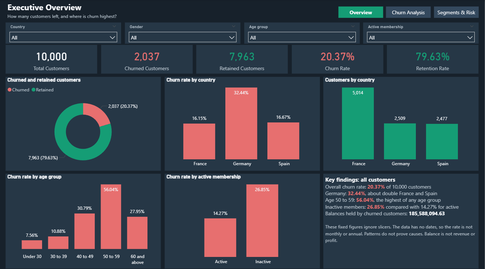

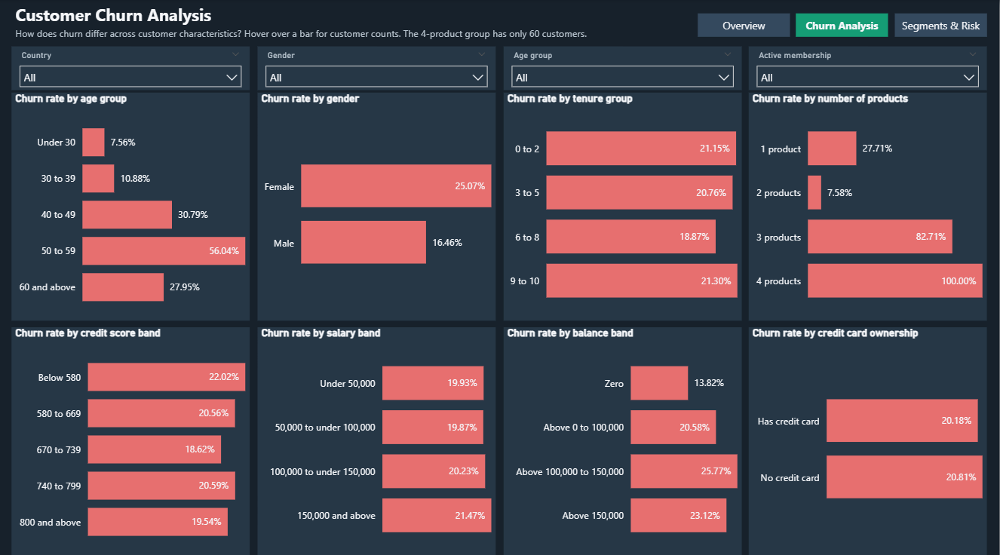

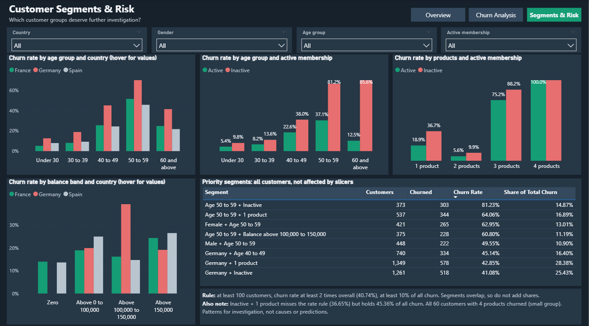

---

## 10. Recommendations

These are **ideas to test**, not guaranteed solutions, because the data shows where churn happens but not why.

| # | Recommendation | Why |
|---|---|---|
| 1 | **Record why and when customers leave** | Without this, the bank cannot learn the causes |
| 2 | **Try re-engaging inactive customers with one product** | They make up 45.36% of everyone who left |
| 3 | **Review German customers with balances above 100,000 to 150,000** | Their churn rate is 39.10%, against about 15% to 16% elsewhere |
| 4 | **Research the needs of customers aged 40 to 59** | They make up 34.87% of customers but 63.48% of leavers |
| 5 | **Check customers with 3 or 4 products before promoting more products** | Their churn rates are very high, but the groups are small |
| 6 | **Test whether a useful second product helps one-product customers** | 2-product customers left least (7.58%) |
| 7 | **Research why women leave more often** | The gap is 25.07% compared with 16.46% |
| 8 | **Track results over time using the dashboard** | Dated data is needed to see improvement |

**How to test an idea:** try it with part of a group, compare that part with a similar part that gets normal service, and expand only what works.

**What not to do:**
- **No discriminatory offers:** don't use age or gender alone to change prices or offers.
- **No overstated losses:** don't call the 185,588,094.63 "lost revenue". It is the balance held by customers who left.
- **No conclusions from small groups:** for example, the 4-product group has only 60 customers.

---

## 11. How We Checked the Results

Every important number was checked more than once:

| Check | Result |
|---|---|
| Data cleaning checks | 24 of 24 passed |
| Python analysis checks | 42 of 42 passed |
| SQL compared with Python | 24 of 24 matched |
| Dashboard compared with Python | 380 of 380 matched |
| Original data file | Never changed |

---

## 12. Limitations

- **No causes:** the data shows patterns, not reasons.
- **No dates:** churn trends over time can't be shown.
- **No profit or revenue data:** the financial impact can't be estimated.
- **Unknown source:** Kaggle lists the data's origin as "Unknown", so the results may not reflect every bank.
- **Small groups:** results for customers with 4 products (60 customers) should be treated with caution.
- **Assumed meanings:** some column meanings, such as what "active" means, are not officially documented.

---

## 13. Conclusion

About 1 in 5 customers left the bank. Churn is concentrated among:
- **Customers aged 40 to 59**
- **German customers with balances above 100,000 to 150,000**
- **Inactive customers**
- **Customers with only one product**

Characteristics such as tenure, credit score and salary made little difference.

The next step for the bank is to record why customers leave, then test retention ideas carefully on these groups and measure the results before expanding them.

---

## 14. Glossary

| Term | Simple meaning |
|---|---|
| **Churn** | A customer leaving the bank |
| **Churn rate** | Percentage of customers in a group who left |
| **Retention rate** | Percentage of customers who stayed |
| **Share of all leavers (churn contribution)** | Percentage of all 2,037 leavers who belong to a group |
| **Segment** | A group of customers who share characteristics, such as Germany + Inactive |
| **Tenure** | How long a customer has been with the bank |
| **Active member** | A customer the bank marks as active (the definition is not given) |
| **Dashboard** | An interactive page of charts and numbers |
| **KPI** | Key Performance Indicator: an important number to track |
| **DAX** | The formula language used in Power BI |
| **SQL** | A language for asking questions of a database |

---

**More detail:** see the [Complete Project Documentation](Complete_Project_Documentation.md) and the phase reports in the `docs` folder.
